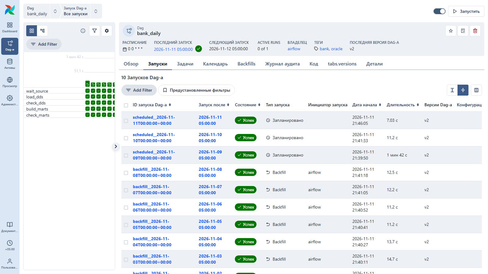
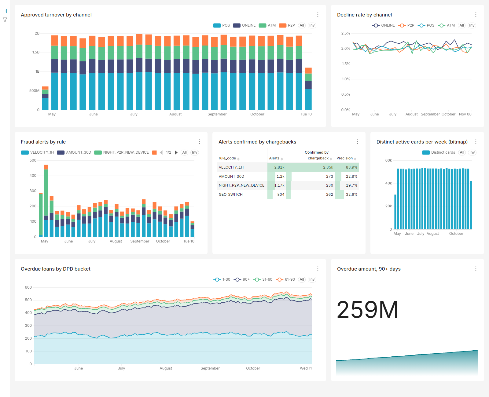
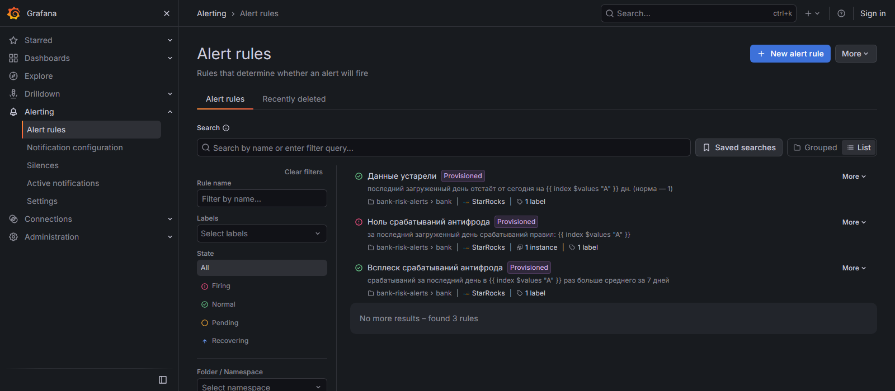

# bank-risk-alerts

Work in progress. Banking reporting and alerting pipeline: Oracle + PL/SQL packages →
Airflow → StarRocks → Superset dashboards and Grafana alerts.

**All data is synthetic** — generated by `src/bra/generator.py`, no real clients or banks.

## Source system (`src` schema)

A small card-and-loan bank: 50 000 clients, ~67 000 cards, 2 000 merchants, ~24 000 card
transactions a day, consumer loans with monthly payments. Four fraud scenarios are planted
for the alerting rules to catch later:

| Scenario | What happens |
|---|---|
| VELOCITY | 6–15 online purchases from an unknown device within an hour |
| AMOUNT | a purchase 8–20× the card's usual amount |
| GEO | a purchase at home, then abroad 30–120 minutes later |
| ATO | account takeover: night-time P2P transfers from a new device |

Confirmed fraud arrives in `fraud_reports` 1–14 days later and only for 90 % of cases,
as chargebacks do in real life. Every day is generated deterministically from a seed, so
reloading a day gives the same rows.

## Warehouse (`dwh` schema) — PL/SQL packages

All warehouse logic lives in Oracle; Python and (later) Airflow only call the packages.

| Object | What it does |
|---|---|
| `pkg_log` + `etl_log` | load journal written in autonomous transactions, so a failed load still leaves `ERROR` with the message and the package line |
| `pkg_dds.load_dims` | `dim_card`, `dim_merchant` via `MERGE` (SCD1); `dim_client` as SCD2 in `[valid_from, valid_to)` versions, built from the client state **as of the load date** (`src.client_history`, an audit table filled by a trigger on `clients`); forward-only |
| `pkg_dds.rebuild_clients` | rebuilds `dim_client` from the audit table and re-points the fact to the new versions via `reload_month` |
| `pkg_dds.load_transactions` | one day of `fct_transactions`: `DELETE` + `INSERT` in one transaction, idempotent; point-in-time `client_sk`; an unknown card fails the load instead of being dropped by a join |
| `pkg_dds.reload_month` | rebuilds a month by partition exchange (`CREATE TABLE ... FOR EXCHANGE`, `EXCHANGE PARTITION`) |
| `fct_transactions` | monthly interval partitions; a one-day query reads one partition |

Six months reconcile with the source to the last tiyn; a daily load takes 0.1–0.3 s.
See [`docs/evidence/step-2-dwh.txt`](docs/evidence/step-2-dwh.txt) and `scripts/check_dwh.py`.

## Marts and fraud rules (`pkg_marts`)

| Object | What it does |
|---|---|
| `mart_daily_turnover` | turnover by day, channel and domestic/foreign; reconciles with the fact table |
| `mart_trx_features` | per-transaction features from analytic windows over 31 days of facts: online count in 1 h, count in 24 h, purchase count and average purchase over the previous 30 days, "device seen before", previous country and minutes since previous transaction |
| `fraud_rule` | rules are **rows, not code**: threshold, minimal history, on/off. Changing a threshold is an `UPDATE`, the next build picks it up and stores it next to each alert |
| `fraud_alert` | one row per (transaction, rule) with the measured value and the threshold used |
| `fraud_label` | chargebacks merged from the source as they arrive (1–14 days late) |
| `mart_loan_dpd` | daily days-past-due snapshot per active loan, buckets `0 / 1-30 / 31-60 / 61-90 / 90+` |
| `v_fraud_rule_quality`, `v_fraud_recall_by_type`, `v_dpd_buckets`, `v_dpd_roll_rate` | report views for dashboards and alerts |

Rule quality is measured only on days with a full 30-day feature history and with
chargebacks old enough to have arrived (from [`docs/evidence/step-3-marts.txt`](docs/evidence/step-3-marts.txt)):

| Rule | Alerts | Precision | Recall |
|---|---|---|---|
| VELOCITY_1H | 2030 | 0.885 | 0.474 |
| AMOUNT_30D | 856 | 0.248 | 0.056 |
| GEO_SWITCH | 595 | 0.331 | 0.052 |
| NIGHT_P2P_NEW_DEVICE | 382 | 0.448 | 0.045 |
| any rule | 3807 | 0.611 | 0.614 |

Recall by fraud card-day is 1.0 for VELOCITY and GEO, 0.99 for ATO and 0.74 for AMOUNT
(cards with fewer than 3 purchases in 30 days have no baseline). The DPD snapshot is checked
loan by loan against an independent Python calculation in `tests/test_marts.py`.

## Orchestration (Airflow 3.4)

`dags/bank_daily.py` runs one day per DAG run (`ds` = the day being loaded):

```
wait_source → load_dds → check_dds → build_marts → check_marts → export_starrocks → check_starrocks
```

- `wait_source` — `SqlSensor` in `reschedule` mode: the source writes a day in one transaction, so "rows exist" means "the day is complete".
- `load_dds`, `build_marts` — call `pkg_dds.run_day` / `pkg_marts.run_day` through `OracleHook.callproc`; all logic stays in PL/SQL.
- `check_dds`, `check_marts` — one SQL row, one column per check (source = warehouse by count and amount, no duplicates, turnover = fact, features for every transaction, rules fired, DPD snapshot built); a failure names the checks that did not pass.
- Explicit `CronDataIntervalTimetable` (in Airflow 3 a bare cron gives `CronTriggerTimetable`, where `ds` is the run time), `catchup=True` and `max_active_runs=1` plus `depends_on_past` on `load_dds`: dimensions load forward only, so days must go in order and without gaps.
- Any task that fails after its retry sends a Telegram message (`on_failure_callback` + `TelegramHook`).

Proof in [`docs/evidence/step-4-airflow.txt`](docs/evidence/step-4-airflow.txt): a 7-day backfill plus 3 catch-up days, all green and reconciled with the source;
then all fraud rules were switched off on purpose, the marts rebuild for 2026-11-10 failed on
`fraud_rules_fired` and the alert went to Telegram; rules back on, same day cleared and green.



## Serving layer (StarRocks 4.1)

StarRocks reads Oracle through a **JDBC catalog** and keeps its own copies of the marts for
dashboards and alerts: [`sql/starrocks/schema.sql`](sql/starrocks/schema.sql).

| Table | Model | Why this model |
|---|---|---|
| `turnover_daily`, `fraud_alert`, `etl_log` | Primary Key | one row per key, a reload replaces it |
| `fraud_label` | Primary Key | chargebacks arrive late for any past day: plain upsert |
| `trx_hourly` | Aggregate | rolled up on write; `BITMAP_UNION` of card ids gives exact distinct cards over any period |
| `loan_dpd` | Duplicate Key, monthly partitions | detail rows for the DPD snapshot |
| `mv_dpd_buckets`, `mv_rule_daily` | async materialized views | refreshed by StarRocks after the base tables change |

- **One file, two callers.** The Airflow task `export_starrocks` runs [`sql/starrocks/export.sql`](sql/starrocks/export.sql)
  for one day, and `scripts/starrocks.sh export FROM TO` runs it for a range.
- **Reloading a day is idempotent.** The export deletes the day and inserts it again.
- **`check_starrocks` reconciles the day with Oracle from inside StarRocks**, which sees both sides.
- **The catalog is created without `oracle.temporal.to-datetime`.** With it, StarRocks pushes the
  date filter down as `timestamp '...'`. Oracle then converts the `DATE` column and scans every
  partition. Without it the filter arrives as `date '...'` and one partition is read.

Full history reconciles with Oracle, see [`docs/evidence/step-6-starrocks.txt`](docs/evidence/step-6-starrocks.txt):
4.18 M transactions, amounts to the tiyn, distinct cards per month.
Distinct cards for the first week of November: summing daily `card_cnt` gives 138 157, the
bitmap gives 52 748, the same as `COUNT(DISTINCT)` in Oracle.

## Dashboards and alerts

**Superset 6.1** reads StarRocks. The dashboard is code: database, datasets, charts and layout are
YAML in [`superset/bank_assets/`](superset/bank_assets) and are imported on every start.



**Grafana 13.3** evaluates three alert rules on StarRocks every minute and sends them to Telegram.
Rules, data source and contact point are provisioned from [`docker/grafana/provisioning/`](docker/grafana/provisioning).

| Rule | Fires when |
|---|---|
| Data is stale | the last loaded day is older than yesterday: the load failed, waits for the source, or Airflow is down |
| Zero fraud alerts | no rule fired on the last loaded day (normally 15–60 alerts a day) |
| Fraud alert spike | the last day has 3× the average of the previous 7 days |

Both failure cases were planted on purpose, see [`docs/evidence/step-7-grafana.txt`](docs/evidence/step-7-grafana.txt):
- All fraud rules were switched off and the day was loaded around the DAG. "Zero fraud alerts" fired about 1.5 minutes later.
- The last day was removed from StarRocks. "Data is stale" fired.

Both reached Telegram and resolved after the fix.



Alerting is layered: Airflow reports a failed task at once, and Grafana watches the data itself,
so it also catches what goes around the DAG or never starts.

## Performance

[`docs/performance.md`](docs/performance.md) has the measurements for one month (672 860 rows),
taken from `v$mystat` and actual plans:

| Method | Time | SQL executions | Redo |
|---|---|---|---|
| Row by row | 11.9 s | 672 865 | 233 MB |
| `BULK COLLECT` + `FORALL` | 3.4 s | 678 | 64 MB |
| One `INSERT ... SELECT` | 2.6 s | 13 | 63 MB |
| One `INSERT /*+ APPEND */ ... SELECT` | 1.3 s | 155 | 0.2 MB |

It also covers plans before and after:
- a function on an indexed column, and why the optimizer skips the index anyway (clustering factor);
- a function on the partition key: `PARTITION RANGE ALL` vs `SINGLE`, 26× slower.

## Run

```bash
cp .env.example .env                      # fill TG_BOT_TOKEN / TG_CHAT_ID for failure alerts
docker compose up -d oracle               # Oracle Free, first start ~2–3 min
py -3.12 -m venv .venv && .venv/Scripts/pip install -e ".[dev]"
.venv/Scripts/bra migrate src
.venv/Scripts/bra init                    # clients, cards, merchants, loan history
.venv/Scripts/bra generate --start 2026-05-01 --end 2026-10-31
.venv/Scripts/bra stats
.venv/Scripts/bra migrate dwh
.venv/Scripts/bra load --start 2024-05-01 --end 2026-10-31   # loan history starts in 2024
.venv/Scripts/bra marts --start 2026-05-01 --end 2026-10-31
.venv/Scripts/python scripts/check_dwh.py
.venv/Scripts/python scripts/check_marts.py
.venv/Scripts/python scripts/perf.py      # measurements for docs/performance.md (~2 min)
.venv/Scripts/pytest                      # integration tests need the running Oracle
docker compose --profile bi up -d         # + Airflow :8080, StarRocks :9030, Superset :8088, Grafana :3000 (no login, local only)
bash scripts/starrocks.sh init            # JDBC catalog, tables, materialized views
bash scripts/starrocks.sh export 2026-05-01 2026-10-31
bash scripts/starrocks.sh check           # StarRocks vs Oracle
docker exec bra-airflow airflow backfill create --dag-id bank_daily     --from-date 2026-11-01 --to-date 2026-11-07 --max-active-runs 1 --reprocess-behavior failed
```

Oracle listens on `localhost:1521`, service `FREEPDB1`, schemas `src` and `dwh`.
Proof of runs is kept in [`docs/evidence/`](docs/evidence/).
