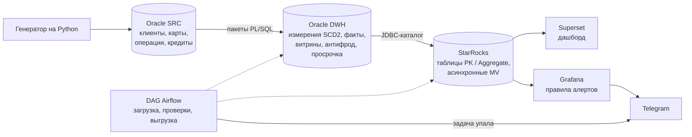
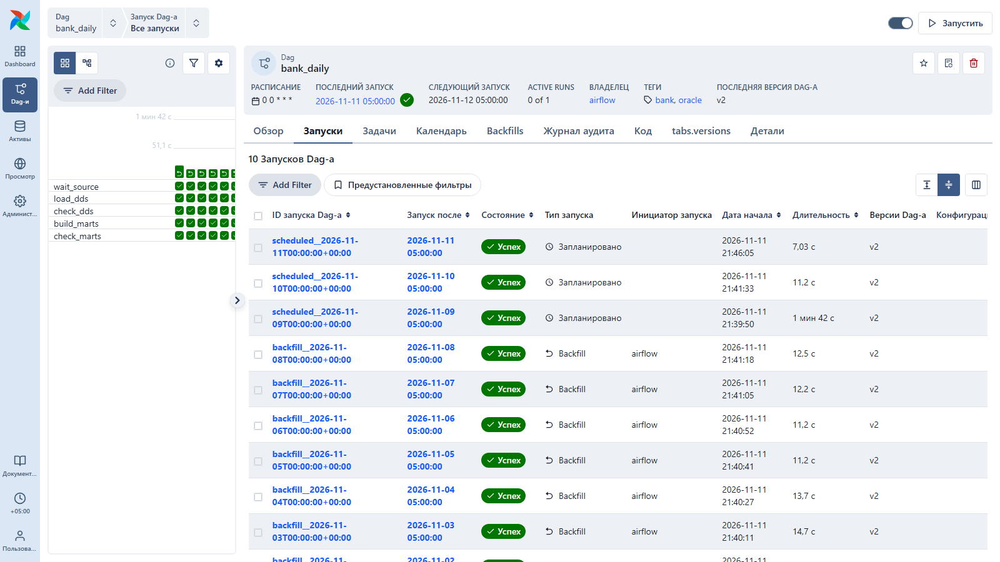
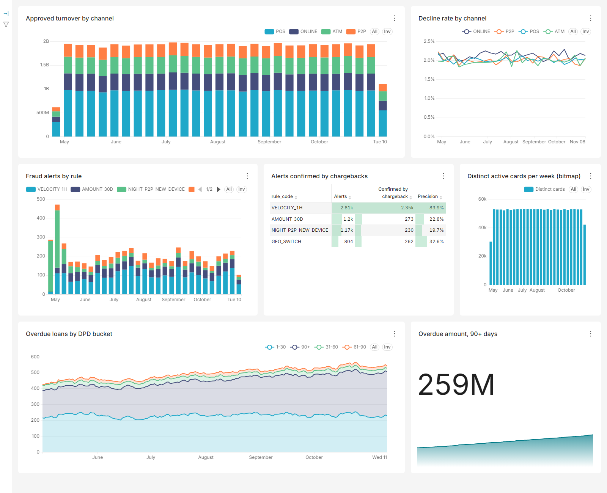
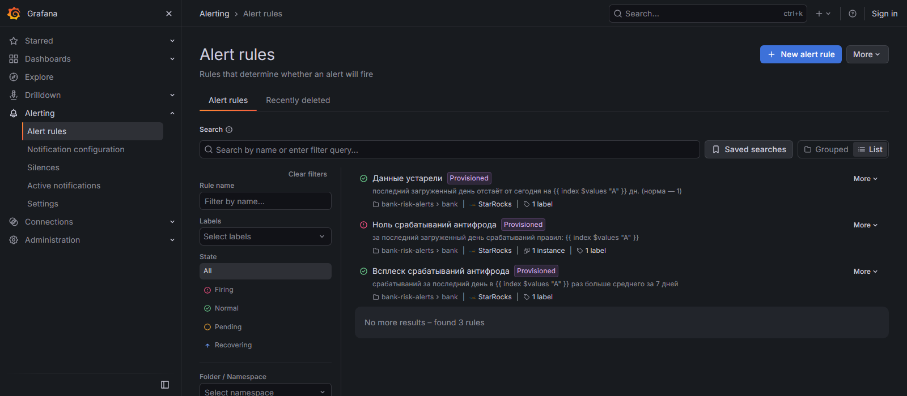

# bank-risk-alerts

[](https://github.com/ikodxd67/bank-risk-alerts/actions/workflows/ci.yml)
· [English version](README.md)

Учебный проект: отчётность, дашборды и алерты банка от источника до сообщения в Telegram.
Учётная система карт и кредитов в Oracle, хранилище на пакетах PL/SQL, Airflow, StarRocks,
дашборд в Superset и алерты в Grafana.

**Все данные сгенерированы.** Их создаёт `src/bra/generator.py`; настоящих клиентов и банков здесь нет.



## Что внутри

- **Хранилище на PL/SQL.** Пакеты с журналом загрузок на автономных транзакциях, SCD2,
  помесячные interval-партиции, обмен партиций, идемпотентная загрузка дня.
- **Правила антифрода как данные.** Пороги лежат в таблице; точность и полнота измерены по
  жалобам, которые приходят с опозданием, и по разметке самого генератора.
- **Просрочка по кредитам.** Ежедневный снимок дней просрочки (DPD), сверенный по каждому
  кредиту с независимым расчётом на Python.
- **Оркестрация.** DAG в Airflow 3 с проверками качества после каждого этапа, бэкфиллом и догоном пропущенных дней.
- **Витрины и BI.** StarRocks поверх JDBC-каталога, дашборд Superset и правила Grafana — всё файлами.
- **Замеры, а не утверждения.** [`docs/performance.md`](docs/performance.md) сравнивает четыре способа загрузки одних и тех же строк и показывает планы.
- **Доказательства.** Вывод каждого шага лежит в [`docs/evidence/`](docs/evidence/). CI собирает часть на Oracle с нуля и запускает все тесты.

## Источник (схема `src`)

Небольшой банк: 50 000 клиентов, ~67 000 карт, 2 000 продавцов, ~24 000 операций в день,
потребительские кредиты с ежемесячными платежами. В данные подложены четыре сценария мошенничества:

| Сценарий | Что происходит |
|---|---|
| VELOCITY | 6–15 онлайн-покупок с незнакомого устройства за час |
| AMOUNT | покупка в 8–20 раз больше обычной для карты |
| GEO | покупка дома, а через 30–120 минут — за границей |
| ATO | захват аккаунта: ночные переводы P2P с нового устройства |

Подтверждение мошенничества (жалоба клиента) приходит через 1–14 дней и только в 90 % случаев.
Генератор детерминирован: повторная генерация дня даёт те же строки.

## Хранилище (схема `dwh`)

Вся логика — в Oracle; Python и Airflow только вызывают пакеты.

| Объект | Что делает |
|---|---|
| `pkg_log` + `etl_log` | журнал загрузок в автономных транзакциях: упавшая загрузка оставляет `ERROR` с текстом и строкой пакета |
| `pkg_dds.load_dims` | `dim_card`, `dim_merchant` через `MERGE` (SCD1); `dim_client` — SCD2 с версиями `[valid_from, valid_to)` по состоянию клиента **на дату загрузки** (журнал `src.client_history`, его пишет триггер на `clients`) |
| `pkg_dds.load_transactions` | день факта: `DELETE` + `INSERT` одной транзакцией; версия клиента на момент операции; неизвестная карта роняет загрузку, а не теряется в соединении |
| `pkg_dds.reload_month` | пересборка месяца обменом партиций |
| `pkg_dds.rebuild_clients` | пересборка `dim_client` по журналу и перевязка факта на новые версии |

Шесть месяцев сходятся с источником до тиына: [`docs/evidence/step-2-dwh.txt`](docs/evidence/step-2-dwh.txt).

## Витрины и антифрод (`pkg_marts`)

- **Обороты** по дням, каналам и признаку «за границей».
- **Признаки операций** оконными функциями: онлайн-операций за час, операций за сутки, число и
  средняя сумма покупок за 30 дней, знакомо ли устройство, предыдущая страна.
- **Правила — строки таблицы `fraud_rule`.** Порог меняется командой `UPDATE`; порог, с которым
  сработало правило, сохраняется рядом со срабатыванием.
- **Просрочка**: корзины `0 / 1-30 / 31-60 / 61-90 / 90+` и переходы между ними (roll rate).

Качество правил — только по дням с полной 30-дневной историей и «созревшими» жалобами
([`docs/evidence/step-3-marts.txt`](docs/evidence/step-3-marts.txt)):

| Правило | Срабатываний | Точность | Полнота |
|---|---|---|---|
| VELOCITY_1H | 2030 | 0,885 | 0,474 |
| AMOUNT_30D | 856 | 0,248 | 0,056 |
| GEO_SWITCH | 595 | 0,331 | 0,052 |
| NIGHT_P2P_NEW_DEVICE | 382 | 0,448 | 0,045 |
| хоть одно правило | 3807 | 0,611 | 0,614 |

Полнота по «карта-день»: VELOCITY и GEO — 1,0, ATO — 0,99, AMOUNT — 0,74 (у карт с менее чем
3 покупками за 30 дней сравнивать не с чем).

## Оркестрация (Airflow 3.4)

```
wait_source → load_dds → check_dds → build_marts → check_marts → export_starrocks → check_starrocks
```

- Один запуск — один день. Сенсор ждёт, пока источник пришлёт день целиком.
- Проверки качества — один SQL, одна колонка на проверку; ошибка называет проверку по имени.
- Дни идут строго по порядку и без дыр (`max_active_runs=1`, `depends_on_past`, `catchup=True`):
  измерения грузятся только вперёд.
- Задача, упавшая после повтора, шлёт сообщение в Telegram.

Бэкфилл 7 дней и подложенный сбой: [`docs/evidence/step-4-airflow.txt`](docs/evidence/step-4-airflow.txt).



## StarRocks 4.1

StarRocks читает Oracle через JDBC-каталог и хранит копии витрин под дашборды и алерты.

| Таблица | Модель | Почему |
|---|---|---|
| `turnover_daily`, `fraud_alert`, `etl_log` | Primary Key | одна строка на ключ, перезагрузка заменяет её |
| `fraud_label` | Primary Key | жалобы приходят с опозданием за любой день — обычный upsert |
| `trx_hourly` | Aggregate | сворачивается при записи; битовая карта номеров карт даёт точное число разных карт за любой период |
| `loan_dpd` | Duplicate Key | подробные строки снимка просрочки |
| `mv_dpd_buckets`, `mv_rule_daily` | асинхронные MV | StarRocks обновляет их сам |

- Вся история сходится с Oracle: 4,18 млн операций, суммы до тиына, число разных карт по месяцам
  ([`docs/evidence/step-6-starrocks.txt`](docs/evidence/step-6-starrocks.txt)).
- Каталог создан без `oracle.temporal.to-datetime`: с этой настройкой фильтр по дате уходит в
  Oracle как `timestamp`, Oracle преобразует колонку и читает все партиции вместо одной.
- Число разных карт за 1–7 ноября: сумма дневных значений — 138 157, битовая карта — 52 748,
  как `COUNT(DISTINCT)` в Oracle.

## Дашборд и алерты

Дашборд Superset 6.1 описан файлами YAML в [`superset/bank_assets/`](superset/bank_assets) и
импортируется при старте.



Grafana 13.3 раз в минуту проверяет три правила на данных StarRocks и пишет в Telegram:

| Правило | Когда срабатывает |
|---|---|
| Данные устарели | последний загруженный день старше вчерашнего |
| Ноль срабатываний антифрода | за последний день не сработало ни одно правило |
| Всплеск срабатываний | за день втрое больше среднего за 7 дней |

Оба сбоя подложены намеренно, оба дошли до Telegram и погасли после исправления:
[`docs/evidence/step-7-grafana.txt`](docs/evidence/step-7-grafana.txt).



Оповещения в два слоя: Airflow сразу сообщает об упавшей задаче, Grafana смотрит на сами
данные и ловит то, что прошло мимо DAG или не запустилось.

## Замеры

Загрузка одного месяца, 672 860 строк ([`docs/performance.md`](docs/performance.md), на английском):

| Способ | Время | SQL-вызовов | Redo |
|---|---|---|---|
| Построчно | 11,9 с | 672 865 | 233 МБ |
| `BULK COLLECT` + `FORALL` | 3,4 с | 678 | 64 МБ |
| Один `INSERT ... SELECT` | 2,6 с | 13 | 63 МБ |
| Он же с `APPEND` | 1,3 с | 155 | 0,2 МБ |

Там же планы «до и после»: функция на индексированной колонке (и почему оптимизатор не берёт
индекс — clustering factor) и функция на ключе партиций (все партиции вместо одной, в 26 раз медленнее).

## Запуск

Команды, адреса сервисов и структура репозитория — в [английском README](README.md#run).
Нужны Docker с ~8 ГБ памяти и Python 3.12.

## Что упрощено

Это стенд на одном ноутбуке. В коде упрощения помечены, в проде было бы иначе:

- **Вход без пароля** в Airflow, Superset и Grafana; у StarRocks — `root` с пустым паролем.
- **По одному контейнеру на систему**: Airflow в режиме `standalone`, StarRocks «всё в одном» с одной копией данных.
- **StarRocks подключается к Oracle владельцем схемы**, а не пользователем только на чтение.
- **Перезагрузка дня в StarRocks — `DELETE` + `INSERT` двумя командами**: транзакции с удалением есть только в режиме shared-data.
- **Журнал клиентов пишет триггер.** CDC по логам базы не нагружал бы каждую запись в источнике.
- **Метаданные Superset лежат в SQLite.**
